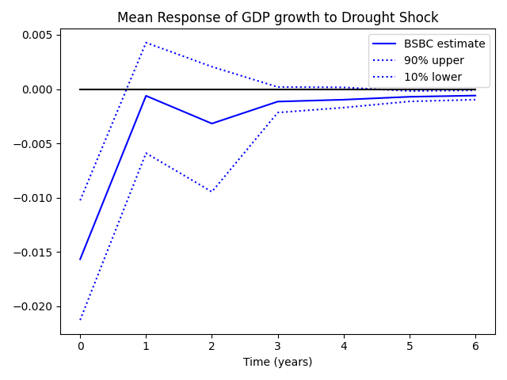
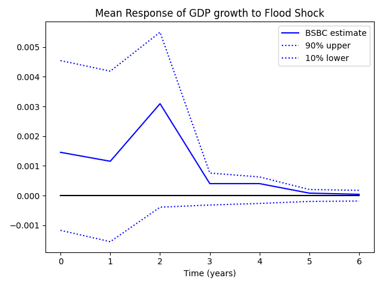

# Replication of Fomby, Ikeda & Loayza (2013): *The Growth Aftermath of Natural Disasters*

A Python replication of

> Fomby, T., Ikeda, Y., & Loayza, N. V. (2013). The Growth Aftermath of Natural Disasters.
> *Journal of Applied Econometrics*, 28(3), 412–434. https://doi.org/10.1002/jae.1273

The original estimation code was written in MATLAB. This repository translates it to Python
(NumPy / pandas / Matplotlib) and speeds up the nested bootstrap with
[Numba](https://numba.pydata.org/) JIT compilation. It was done as a replication project for
EC 532 at Boğaziçi University (Spring 2026).

**Original replication package:** JAE Data Archive,
http://qed.econ.queensu.ca/jae/2013-v28.3/fomby-ikeda-loayza/

**Documents in this repository:**
- [**Replication Report (PDF)**](report/replication_report.pdf) ([LaTeX source](report/paper.tex))
- [**Presentation Slides (PDF)**](slides/replication_slides.pdf) ([Beamer source](slides/presentation.tex))

---

## What the paper does

The paper asks how GDP growth responds, year by year, to four kinds of natural disaster: droughts,
floods, earthquakes and storms. It also splits growth into agricultural and non-agricultural parts.
The model is a fixed-effects panel VARX(2,2) estimated on 84 countries (60 developing, 24 developed)
over 1960–2007. Disaster intensity enters as exogenous variables.

With a lagged dependent variable and a short time dimension, the usual fixed-effects (LSDV) estimator
suffers from **Nickell bias**. The authors handle this with a **bootstrap bias correction (BSBC)**
applied directly to the mean responses (dynamic multipliers). Inference comes from a **nested
bootstrap** (1,000 × 1,000 draws).

Main findings, all reproduced here:

- **Droughts** lower GDP growth in developing countries, both on impact and cumulatively.
- **Moderate floods** have a small *positive* cumulative effect on growth.
- **Earthquakes** raise non-agricultural growth in the following year (reconstruction).
- **Storms** have no significant effect.
- **Severe** disasters are more harmful, and the flood gains disappear when floods are severe.
- **Developed** economies are much more resilient at the aggregate level.

## Headline result

Mean response of GDP growth in developing countries (BSBC, Table III of the paper):

| Disaster    | Horizon    | Original     | This replication |
|-------------|------------|--------------|------------------|
| Droughts    | Year 0     | −0.0160\*\*  | −0.0157\*\*      |
| Droughts    | Cumulative | −0.0214\*\*  | −0.0212\*\*      |
| Floods      | Cumulative | 0.0062\*     | 0.0061\*         |
| Earthquakes | Cumulative | 0.0067       | 0.0070           |
| Storms      | Cumulative | −0.0020      | −0.0021          |

\* significant at the one-tailed 10% level, \*\* at 5%.

Across the full tables (GDP, agricultural and non-agricultural growth, moderate and severe
disasters), the replicated point estimates are within about 0.001 of the published values, and the
significance flags agree in almost every cell. The remaining small gaps are what you'd expect from
different bootstrap random draws.

<p align="center">
  
  
</p>
<p align="center"><em>BSBC mean response of GDP growth to drought (left) and flood (right) shocks,
developing countries, with 10%–90% bootstrap bands.</em></p>

## Repository structure

```
.
├── python/                    # Python translation (this project)
│   ├── apply_BSBC.py          # BSBC estimates      -> Tables III, IV; Tables B-II–B-IV (supplement)
│   ├── apply_severe_BSBC.py   # BSBC, severe vs moderate disasters -> Table V
│   ├── apply_LSDV.py          # LSDV + Monte Carlo inference       -> Table B-I (supplement)
│   ├── apply_severe_LSDV.py   # LSDV, severe vs moderate disasters
│   ├── helpers.py             # psimat / meanpsi / btst (plain NumPy)
│   └── helpers_numba.py       # same functions, JIT-compiled with Numba (used by the BSBC scripts)
├── figures/                   # Mean-response plots produced by the scripts
│   ├── BSBC/{Developing,Developed}/{moderate,severe}/
│   └── LSDV/{Developing,Developed}/{moderate,severe}/
├── report/                    # Replication paper (LaTeX source + compiled PDF)
│   ├── paper.tex
│   └── replication_report.pdf
├── slides/                    # Beamer presentation (LaTeX source + compiled PDF)
│   ├── presentation.tex
│   └── replication_slides.pdf
└── original_package/          # Files from the authors' replication package (see its README)
    ├── data/                  # Estimation datasets (CSV)
    ├── matlab/                # Original MATLAB code
    ├── stata/                 # Original Stata data-preparation code
    └── readme.fil.txt         # Original readme
```

The Python scripts mirror the original MATLAB files one-to-one (`apply_BSBC.m` → `apply_BSBC.py`,
etc.), so you can compare them side by side.

## How to run

Requires Python 3.10 or newer. Tested with Python 3.14, NumPy 2.3, pandas 2.3, Matplotlib 3.10 and Numba 0.65.

```bash
git clone https://github.com/toprak-ozdemir/fomby-2013-disasters-replication.git
cd fomby-2013-disasters-replication
python -m venv .venv && source .venv/bin/activate
pip install -r requirements.txt

python python/apply_BSBC.py
```

Each script prints a results table (mean responses by year, cumulative effect and significance
stars) and opens one plot per disaster type.

To switch samples or growth measures, edit two lines near the top of a script:

```python
dep = 'Mean Response of GDP growth to'   # plot title prefix
DATASET = 'dev_grow'   # dev_grow, dev_agr, dev_non, rich_grow, rich_agr, rich_non
```

`dev_*` is the developing-country sample and `rich_*` the developed-country sample. `*_grow`,
`*_agr` and `*_non` are GDP, agricultural and non-agricultural growth. The severe-disaster scripts
are meant for the developing-country samples only. The paper doesn't report severe results for
developed countries. The `rich_*` files contain no severe floods at all, so the severe-flood
regressors are all zero and the LSDV moment matrix is singular.

**Runtime (Apple Silicon laptop):** `apply_LSDV.py` takes about a minute (30,000 Monte Carlo
draws). Each BSBC run takes about 25 minutes. The first run also spends a few seconds JIT-compiling. Without Numba, the nested
bootstrap would take more than 10 hours per run in plain Python.

## Notes on the replication

- **Data preparation was not redone.** The estimation uses the authors' processed datasets.
  The Stata scripts that build them from the raw panel are kept under `original_package/stata/`
  for reference.
- **Observation counts.** The original readme reports 2,097 observations for GDP growth in
  developing countries. The distributed `dev_grow` file has 1,866 rows, and that's what both the
  original code and this replication actually estimate on. Coefficients still match closely.
- **Lag order.** `apply_LSDV.py` prints AIC and SBC for the chosen `p`, `q`. If you re-run it with
  p = q = 1, 2, 3, SBC favours p = q = 1 and AIC favours p = q = 3. The paper's choice of
  p = q = 2 sits between them.

## Citation

If you use this code, please cite the original paper:

```bibtex
@article{fomby2013growth,
  author  = {Fomby, Thomas and Ikeda, Yuki and Loayza, Norman V.},
  title   = {The Growth Aftermath of Natural Disasters},
  journal = {Journal of Applied Econometrics},
  year    = {2013},
  volume  = {28},
  number  = {3},
  pages   = {412--434},
  doi     = {10.1002/jae.1273}
}
```

and the replication package:

> Fomby, T., Ikeda, Y., & Loayza, N. V. (2013). Data and code for "The Growth Aftermath of Natural
> Disasters". *Journal of Applied Econometrics Data Archive*.
> http://qed.econ.queensu.ca/jae/2013-v28.3/fomby-ikeda-loayza/

GitHub's "Cite this repository" button (generated from [`CITATION.cff`](CITATION.cff)) gives a
citation for this replication itself.

## License

The Python code and figures in this repository are released under the [MIT License](LICENSE).
Files in [`original_package/`](original_package/) belong to Fomby, Ikeda and Loayza. They are
redistributed here unchanged (apart from the CSV conversion described in that folder) for
convenience and attribution, and the MIT License does not apply to them.

The original MATLAB code was written by Yuki Ikeda (2011). The Python translation and the Numba
optimization are by Toprak Özdemir.
